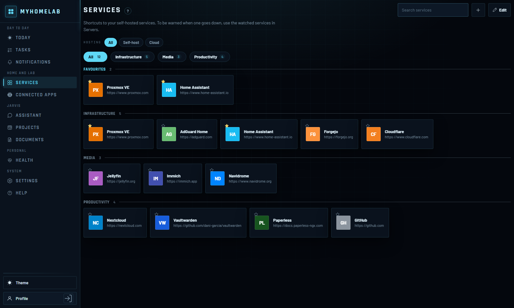
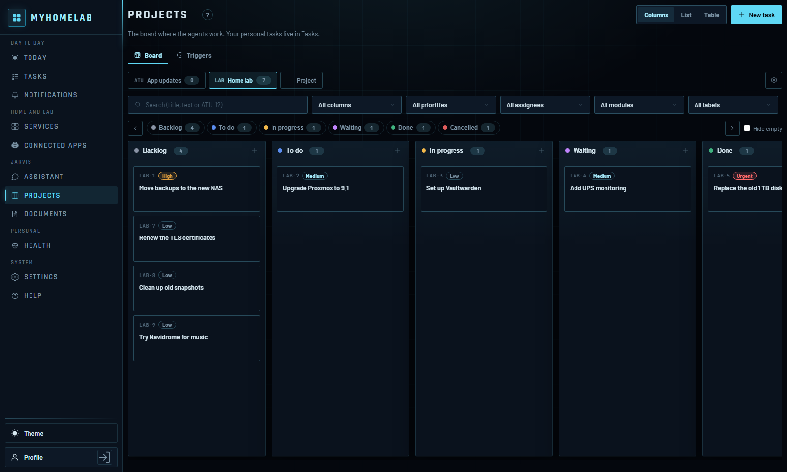
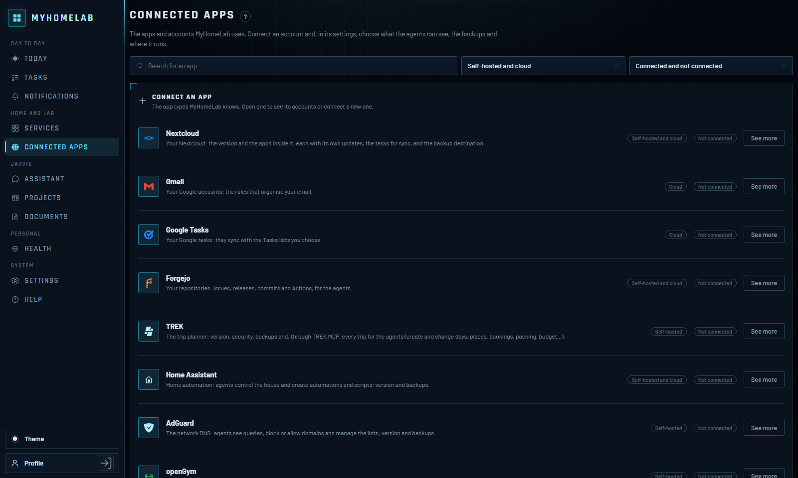
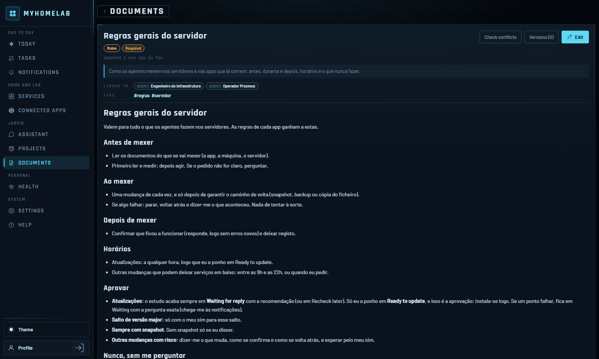

<div align="center">

# MyHomeLab

**A self-hosted control panel for your Proxmox home lab — with a team of AI agents that know it.**

[](https://github.com/TTiagoSousa/MyHomeLab/actions/workflows/ci.yml)
[](https://github.com/TTiagoSousa/MyHomeLab/actions/workflows/codeql.yml)
[](https://github.com/TTiagoSousa/MyHomeLab/releases/latest)
[](./LICENSE)

🇵🇹 [Ler em português](./README.pt-PT.md)

</div>

MyHomeLab brings the day-to-day of a home lab into one place: your Proxmox servers and the
machines on them, the apps you self-host, watched services with alerts, Gmail organisation,
a project board and personal tasks — and **Jarvis**, a team of AI agents built on Claude that
can read and act on all of it, from the browser or the Android app.

The agents follow **rules you write as documents**: how to study an update, how to install it,
how to handle a service that went down. New versions of your apps are studied, installed one at
a time with a snapshot first, and verified afterwards — and anything that needs your decision
lands in your notifications.

It installs as a **single LXC container on Proxmox** (Node, PostgreSQL and nginx inside, no
Docker) and updates itself from the app, with automatic rollback.

<p align="center">
  
  
  
  
</p>

## Features

| | |
|---|---|
| **Jarvis and the agent team** | A main agent routes each request to specialists (servers, email, travel, health…). The team, their prompts and their tools live in the database and are edited in the app. Each user signs in with their own Claude subscription (a `claude setup-token` token). |
| **Rules as documents** | Agents read the documents linked to them (an app, a server, an agent) before acting. They can propose changes; you approve them. |
| **App updates on autopilot** | A new version becomes a task: the agent studies the release notes and open issues, you approve (or it installs low-risk ones by itself), it installs with a snapshot, verifies and rolls back if needed. Works for apps on your servers, Home Assistant parts, Nextcloud apps and the Proxmox host. |
| **Projects and tasks** | A project board (columns, comments, schedules for the agents) and a personal to-do list. |
| **Servers** | Proxmox nodes, storages and every VM/container; SMART disk health with alerts; commands run over SSH with a snapshot before anything that changes the machine. |
| **Watched services** | HTTP(S) or TCP checks every N minutes. Alerts open when something goes down and close when it comes back. |
| **Integrations** | Home Assistant, AdGuard Home, Nextcloud, Forgejo, TREK, openGym, GamesTracker Vault, Immich, Paperless-ngx, solidtime, Stirling-PDF, Plane, Gitea Mirror, Jellyfin, Dispatcharr, Coolify, Nginx Proxy Manager, ClickHouse, PostgreSQL, Vaultwarden and Infisical — each with a connections page showing the token permissions and the API calls MyHomeLab makes. |
| **Email** | Gmail, Outlook and IMAP accounts. Gmail rules by sender, subject, keywords or mail type, label hierarchies, and rules proposed by the AI from your inbox. |
| **Tasks sync** | Nextcloud (CalDAV) task lists into Google Tasks. |
| **Backups** | Scheduled backups of your apps and of MyHomeLab itself, with retention. |
| **Health** | Import a Huawei Health export: sleep, heart rate, SpO₂, stress, steps and workouts with GPS maps. |
| **Notifications** | One place for every alert and every question the agents ask you. |
| **Android app** | The whole app on your phone. It offers new versions by itself. |
| **Multi-user, three languages** | Everything is per user. Portuguese, English and Spanish. |
| **Self-updating** | The admin updates from **Admin → Version**; a failed step rolls back to the previous version. |

## Install on Proxmox

On the **Proxmox host shell**, run:

```bash
bash -c "$(curl -fsSL https://raw.githubusercontent.com/TTiagoSousa/MyHomeLab/main/deploy/proxmox/ct-create.sh)"
```

A menu (default or advanced settings) creates a Debian 13 container and installs Node,
PostgreSQL, nginx and the app inside it. Sign in with **admin / admin** and change it before
exposing the app. Full guide: [`docs/deployment.md`](./docs/deployment.md).

After installing, the **Help** page in the app walks you through each key, token and
integration.

### Android app

Download `MyHomeLab-X.Y.Z.apk` from the [latest release](https://github.com/TTiagoSousa/MyHomeLab/releases/latest),
or from your own server at `https://<your MyHomeLab>/api/app/android/download`. On the phone,
allow the browser to install apps when Android asks; after that the app offers new versions by
itself.

## How it works

```
 Browser / Android ──► nginx (CT) ─┬─ /        React app (static)
                                   └─ /api/*   NestJS API ──► PostgreSQL (in the CT)
                                                  │
                                                  ├─► Claude (per-user subscription token)
                                                  ├─► Proxmox API + SSH
                                                  ├─► Gmail / Google Tasks (OAuth), Outlook, IMAP
                                                  └─► your self-hosted apps' APIs
```

Everything the app talks to is **outbound** — no webhook, no extra open port. Secrets (OAuth
tokens, AI keys, server and app credentials) are encrypted at rest with AES-256-GCM.

## Development

Requires **Node 22+** and a PostgreSQL database.

```bash
npm install
cp apps/backend/.env.example apps/backend/.env    # DATABASE_URL, JWT_SECRET, TOKEN_ENCRYPTION_KEY…
cd apps/backend && npx prisma migrate deploy && cd ../..
npm run dev                                       # shared + backend (:3100) + frontend (:5180)
```

| Command | What it does |
|---|---|
| `npm run dev` | shared package in watch mode, backend and frontend |
| `npm run build` | shared → backend → frontend |
| `npm test` | backend unit tests |
| `npm run release -- --dry-run` | preview the next release and its notes |

```
apps/backend      NestJS 11 · Prisma 7 · PostgreSQL
apps/frontend     React 19 · Vite · SCSS · i18next
apps/mobile       Android app (React Native + Expo)
packages/shared   types and constants used by both sides
deploy/proxmox    LXC installer, updater and backup scripts
docs              documentation
releases          release notes (en, pt-PT, es) per version
```

## Documentation

Start at [`docs/README.md`](./docs/README.md): architecture, API, deployment and the
development guides.

## Contributing

Contributions are welcome — read [`CONTRIBUTING.md`](./CONTRIBUTING.md) first. Please follow
the [Code of Conduct](./CODE_OF_CONDUCT.md), and report security issues privately as described
in [`SECURITY.md`](./SECURITY.md).

## License

[GPL-3.0-only](./LICENSE).
