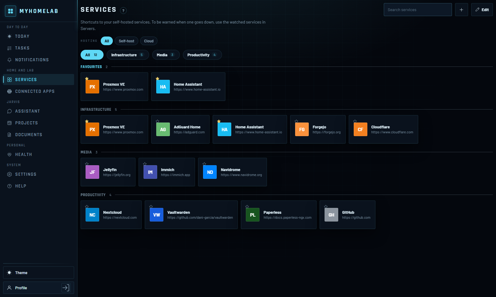
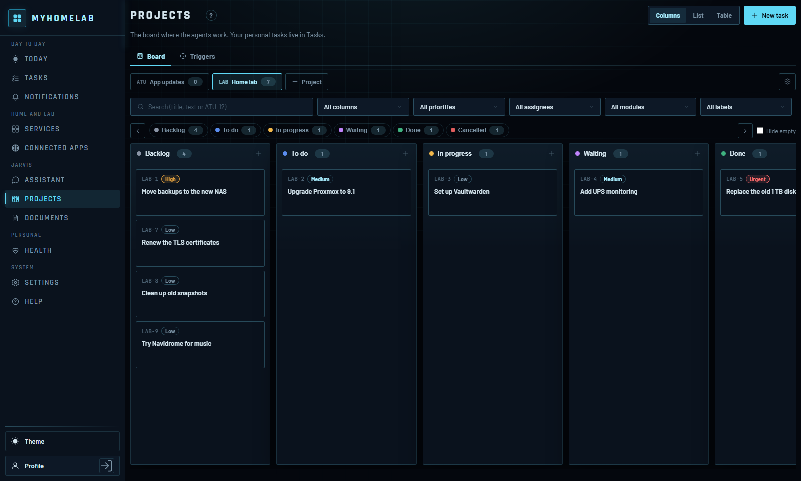
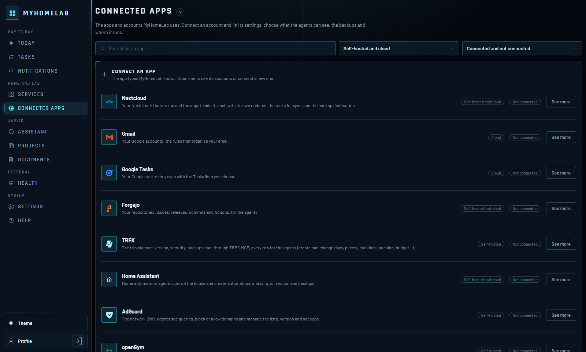
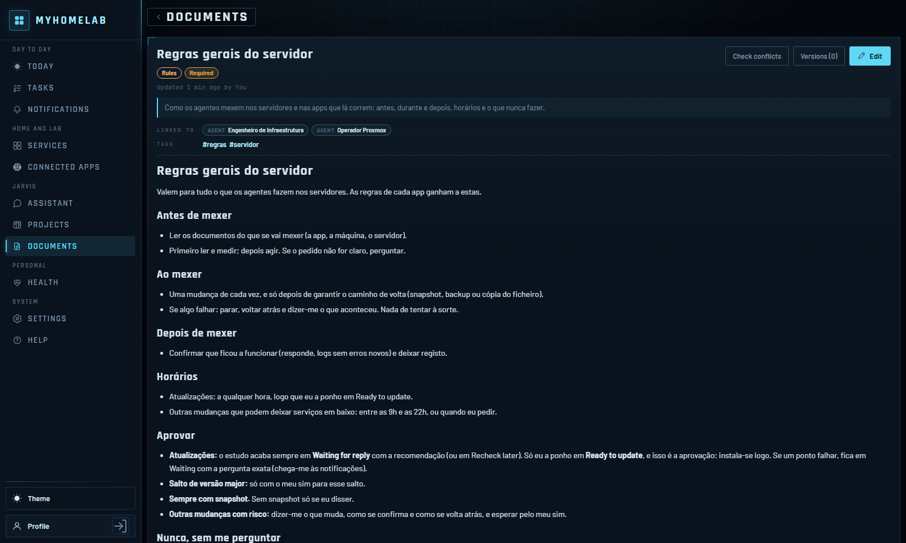

<div align="center">

# MyHomeLab

**Um painel de controlo self-hosted para o teu home lab em Proxmox — com uma equipa de agentes de IA que o conhece.**

[](https://github.com/TTiagoSousa/MyHomeLab/actions/workflows/ci.yml)
[](https://github.com/TTiagoSousa/MyHomeLab/actions/workflows/codeql.yml)
[](https://github.com/TTiagoSousa/MyHomeLab/releases/latest)
[](./LICENSE)

🇬🇧 [Read in English](./README.md)

</div>

O MyHomeLab junta num só sítio o dia a dia de um home lab: os servidores Proxmox e as máquinas
deles, as apps que alojas, os serviços vigiados com alertas, a organização do Gmail, um quadro
de projetos e as tarefas pessoais — e o **Jarvis**, uma equipa de agentes de IA feita com o
Claude que lê e mexe em tudo isto, no browser ou na app Android.

Os agentes seguem **regras que escreves como documentos**: como se estuda uma atualização, como
se instala, o que fazer quando um serviço vai abaixo. As versões novas das tuas apps são
estudadas, instaladas uma de cada vez com snapshot antes e verificadas no fim — e o que precisar
de uma decisão tua chega às notificações.

Instala-se como **um único container LXC no Proxmox** (Node, PostgreSQL e nginx lá dentro, sem
Docker) e atualiza-se a partir da própria app, com rollback automático.

<p align="center">
  
  
  
  
</p>

## Funcionalidades

| | |
|---|---|
| **O Jarvis e a equipa de agentes** | Um agente principal passa cada pedido ao especialista certo (servidores, email, viagens, saúde…). A equipa, os prompts e as ferramentas ficam na base de dados e editam-se na app. Cada utilizador entra com a sua subscrição do Claude (um token do `claude setup-token`). |
| **Regras como documentos** | Antes de agir, os agentes leem os documentos ligados a eles (uma app, um servidor, um agente). Podem propor alterações; tu aprovas. |
| **Atualizações em piloto automático** | Uma versão nova vira tarefa: o agente estuda as notas e as issues abertas, tu aprovas (ou ele instala sozinho as de risco baixo), instala com snapshot, verifica e volta atrás se for preciso. Serve para as apps nos teus servidores, as peças do Home Assistant, as apps do Nextcloud e o host Proxmox. |
| **Projetos e tarefas** | Um quadro de projetos (colunas, comentários, disparos para os agentes) e uma lista de tarefas pessoal. |
| **Servidores** | Nós Proxmox, armazenamentos e todas as VMs/containers; saúde SMART dos discos com alertas; comandos por SSH com snapshot antes de tudo o que muda a máquina. |
| **Serviços vigiados** | Verificações HTTP(S) ou TCP de N em N minutos. O alerta abre quando algo vai abaixo e fecha quando volta. |
| **Integrações** | Home Assistant, AdGuard Home, Nextcloud, Forgejo, TREK e openGym — cada uma com uma página de ligações com as permissões do token e as chamadas que o MyHomeLab faz. |
| **Email** | Contas Gmail, Outlook e IMAP. Regras do Gmail por remetente, assunto, palavras ou tipo de email, etiquetas em hierarquia e regras propostas pela IA a partir da tua caixa. |
| **Sincronizar tarefas** | Listas de tarefas do Nextcloud (CalDAV) para o Google Tasks. |
| **Backups** | Backups agendados das tuas apps e do próprio MyHomeLab, com retenção. |
| **Saúde** | Importa um export da Huawei Health: sono, frequência cardíaca, SpO₂, stress, passos e treinos com mapa GPS. |
| **Notificações** | Um só sítio para todos os alertas e todas as perguntas que os agentes te fazem. |
| **App Android** | A app toda no telemóvel. Avisa sozinha quando há versão nova. |
| **Vários utilizadores, três línguas** | Tudo é de cada utilizador. Português, inglês e espanhol. |
| **Atualiza-se sozinho** | O admin atualiza em **Admin → Versão**; se um passo falhar, volta à versão anterior. |

## Instalar no Proxmox

Na **shell do host Proxmox**, corre:

```bash
bash -c "$(curl -fsSL https://raw.githubusercontent.com/TTiagoSousa/MyHomeLab/main/deploy/proxmox/ct-create.sh)"
```

Um menu (definições por omissão ou avançadas) cria um container Debian 13 e instala lá dentro o
Node, o PostgreSQL, o nginx e a app. Entra com **admin / admin** e muda-o antes de expor a app.
Guia completo: [`docs/deployment.md`](./docs/deployment.md).

Depois de instalar, a página **Ajuda** da app explica passo a passo cada chave, token e
integração.

### App Android

Descarrega o `MyHomeLab-X.Y.Z.apk` da [release mais recente](https://github.com/TTiagoSousa/MyHomeLab/releases/latest),
ou do teu próprio servidor em `https://<o teu MyHomeLab>/api/app/android/download`. No
telemóvel, autoriza o browser a instalar apps quando o Android pedir; depois disso a própria app
avisa quando há versão nova.

## Como funciona

```
 Browser / Android ──► nginx (CT) ─┬─ /        app React (estática)
                                   └─ /api/*   API NestJS ──► PostgreSQL (no CT)
                                                  │
                                                  ├─► Claude (token da subscrição de cada utilizador)
                                                  ├─► API do Proxmox + SSH
                                                  ├─► Gmail / Google Tasks (OAuth), Outlook, IMAP
                                                  └─► as APIs das tuas apps
```

Tudo o que a app contacta é **de saída** — sem webhooks nem portas extra abertas. Os segredos
(tokens OAuth, chaves de IA, credenciais dos servidores e das apps) ficam cifrados com
AES-256-GCM.

## Desenvolvimento

Precisa do **Node 22+** e de uma base de dados PostgreSQL.

```bash
npm install
cp apps/backend/.env.example apps/backend/.env    # DATABASE_URL, JWT_SECRET, TOKEN_ENCRYPTION_KEY…
cd apps/backend && npx prisma migrate deploy && cd ../..
npm run dev                                       # shared + backend (:3100) + frontend (:5180)
```

| Comando | O que faz |
|---|---|
| `npm run dev` | o pacote partilhado em watch, o backend e o frontend |
| `npm run build` | shared → backend → frontend |
| `npm test` | os testes do backend |
| `npm run release -- --dry-run` | ver a próxima release e as notas |

```
apps/backend      NestJS 11 · Prisma 7 · PostgreSQL
apps/frontend     React 19 · Vite · SCSS · i18next
apps/mobile       app Android (React Native + Expo)
packages/shared   tipos e constantes dos dois lados
deploy/proxmox    instalador LXC, atualização e backups
docs              documentação
releases          notas das releases (en, pt-PT, es) por versão
```

## Documentação

Começa em [`docs/README.md`](./docs/README.md) (em inglês): arquitetura, API, deploy e os guias
de desenvolvimento.

## Contribuir

Contribuições são bem-vindas — lê primeiro o [`CONTRIBUTING.md`](./CONTRIBUTING.md). Segue o
[Código de Conduta](./CODE_OF_CONDUCT.md) e reporta problemas de segurança em privado, como diz o
[`SECURITY.md`](./SECURITY.md).

## Licença

[GPL-3.0-only](./LICENSE).
